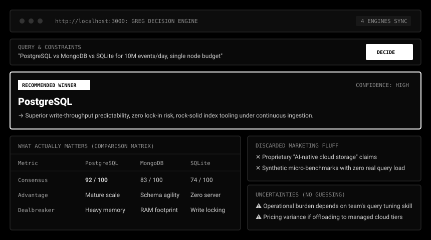
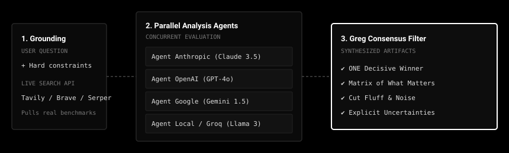

# Greg: Direct AI Decision Engine

> Stop wasting hours reading pages of blog posts, sponsored reviews, and marketing fluff.  
> Greg researches real options using live web search, compares what actually matters, cites verified sources, and delivers **one clear recommendation**.



---

## What Greg Does

- **One Decisive Pick**: No fence-sitting or endless pros and cons. Greg gives you a single recommended choice and explains the exact trade-off you accept.
- **Real Live Web Search**: Connects to Tavily, Brave Search, or Serper to retrieve grounded benchmark and spec data.
- **Source Citations**: Every claim is linked back to actual web citations.
- **Facts vs Assumptions vs Unknowns**: Separates proven facts from working assumptions and unverified unknowns. Never guesses.
- **Explains Rejections**: Clear rationale for why alternative contenders were dismissed.
- **Noise Filter**: Deliberately identifies and discards marketing buzzwords, superficial feature lists, and synthetic benchmarks.
- **Local Persistence & Export**: Stores past decisions in an embedded SQLite database (`data/greg.db`) with one-click Markdown download and clipboard sharing.
- **Editorial Dark UI**: Linear-inspired dark interface with typography, quick presets, zero-framework lightweight runtime, plus interactive terminal CLI.

---

## Architecture Overview



```
[ User Query + Constraints ]
             │
             ▼
    [ Live Search API ]  (Tavily / Brave / Serper)
             │
             ▼
   [ Grounded Prompt ]   (Verified Web Citations)
             │
             ▼
     [ Real LLM Engine ] (Claude 3.5 Sonnet / GPT-4o / Gemini 1.5 / Groq / Ollama)
             │
             ▼
  [ Decision Synthesis ]
             ├─ One Recommended Winner & Main Trade-off
             ├─ Comparison Matrix of Real Factors
             ├─ Verified Facts vs Assumptions vs Unknowns
             ├─ Rejected Alternatives with Rationale
             └─ Discarded Marketing Fluff
             │
             ▼
   [ SQLite Persistence & Export ] (data/greg.db + Markdown)
```

---

## Tech Stack

- **Runtime**: Node.js (v18+) with TypeScript
- **Database**: SQLite via `better-sqlite3` (WAL mode enabled)
- **Validation**: Zod (strict payload validation)
- **Search Providers**: Tavily Search API, Brave Search API, Serper Google API
- **LLM Providers**: Anthropic Claude, OpenAI, Google Gemini, Groq, Ollama
- **Frontend**: Editorial dark UI in pure vanilla TypeScript/HTML/CSS (zero frontend dependencies or heavy bundles)

---

## Quickstart

### Prerequisites
- Node.js 18 or newer

### 1. Clone & Install
```bash
git clone https://github.com/anosistaken/ResearchingAgent.git
cd ResearchingAgent
npm install
```

### 2. Configure Environment Keys
Copy `.env.example` to `.env`:
```bash
cp .env.example .env
```

Configure at least **one LLM provider** and **one Search provider**:

#### Recommended Search Providers (choose one)
- **Tavily AI Search** (1,000 free searches/mo): [tavily.com](https://tavily.com) -> `TAVILY_API_KEY`
- **Brave Search API** (2,000 free queries/mo): [brave.com/search/api/](https://brave.com/search/api/) -> `BRAVE_API_KEY`
- **Serper API** (2,500 free searches): [serper.dev](https://serper.dev) -> `SERPER_API_KEY`

#### Recommended LLM Providers (choose one)
- **Anthropic Claude**: [console.anthropic.com](https://console.anthropic.com) -> `ANTHROPIC_API_KEY`
- **OpenAI**: [platform.openai.com](https://platform.openai.com) -> `OPENAI_API_KEY`
- **Google Gemini**: [aistudio.google.com](https://aistudio.google.com) -> `GEMINI_API_KEY`
- **Groq Cloud**: [console.groq.com](https://console.groq.com) -> `GROQ_API_KEY`
- **Ollama**: Local and offline -> `OLLAMA_ENABLED=true`

> **Note**: Greg requires real API keys. If keys are missing, the server will display a clear setup error rather than generating fake or mocked responses.

### 3. Run the Application
```bash
# Development mode with live reload
npm run dev

# Or compile and run production build
npm run build
npm start
```

Open **`http://localhost:3000`** in your browser, or type queries directly in your terminal.

---

## Output Breakdown

Every decision card provides:

1. **Recommended Pick**: Single best option, tagline, and accepted trade-off.
2. **Direct Comparison Matrix**: Evaluates options only on factors that affect real production usage.
3. **Verified Facts vs Assumptions vs Unknowns**: 3-column breakdown ensuring you know what is confirmed vs unverified.
4. **Why Alternatives Were Rejected**: Concrete explanations for each rejected contender.
5. **Discarded Fluff**: Marketing claims and buzzwords that were intentionally cut.
6. **Source Citations**: Clickable links to every search result used to ground the research.
7. **Decision History & Export**: Instant access to past runs in SQLite, Markdown export, and deletion.

---

## API Routes

- `GET /`: Editorial web application.
- `GET /api/status`: System readiness and configured provider status.
- `GET /api/decisions`: List recent decisions from SQLite history.
- `GET /api/decisions/:id`: Retrieve full decision report by ID.
- `GET /api/decisions/:id/export`: Download decision report as Markdown.
- `DELETE /api/decisions/:id`: Delete a saved decision record.
- `POST /api/decisions`: Submit a new research decision (`{ topic: string, constraints?: string }`).

---

## Syncing Changes

To sync changes to GitHub:
```bash
npm run sync -- "your commit message"
```

---

## Open Source Guidelines

- [Contributing Guide](CONTRIBUTING.md)
- [Security & Responsible Use Policy](SECURITY.md)
- [Agent Standards](agents.md)

---

## License

[MIT](LICENSE)
